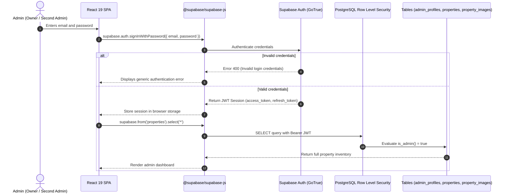

# AMMAN REAL ESTATE – System Architecture

## 1. Executive Overview

AMMAN REAL ESTATE is transitioning from an initial static property showcase into a production-ready property management system deployed with a **₹0 initial operating budget**.

To achieve zero infrastructure costs while maintaining enterprise-grade security and relational integrity, the architecture leverages **Supabase** (Serverless Backend-as-a-Service) for managed PostgreSQL and administrative authentication, paired with **Cloudflare R2** for object storage and **Vercel / Cloudflare Pages** for static frontend hosting.

The existing Java Spring Boot backend in `backend/` remains preserved as an offline architectural reference and backup.

The system serves two primary stakeholder groups:
1. **Public Visitors & Property Buyers:** Exploring published residential houses, land plots, and commercial properties across Thanjavur, with direct WhatsApp inquiry generation. Public browsing requires zero authentication.
2. **Business Administrators (Owner & Second Administrator):** Managing property inventory, uploading architectural photography, setting specifications, and publishing listings directly from mobile and desktop devices.

---

## 2. Technology Stack & Zero-Cost Rationale

| Layer | Technology | Specification | Zero-Cost Architectural Rationale |
| :--- | :--- | :--- | :--- |
| **Frontend** | React 19 + TypeScript + Vite | React 19, TypeScript 5.8+, Tailwind CSS v4, `@supabase/supabase-js` | Lightweight single-page application (SPA), instant responsive UI, mobile-first performance, compatible with free edge static hosting. |
| **Backend & DB** | Supabase (PostgreSQL 15+) | Managed PostgreSQL with Row Level Security (RLS) | 500 MB database free tier, real-time subscriptions, built-in backups, zero VPS compute costs ($0/month). |
| **Authentication** | Supabase Auth | GoTrue Email/Password with JWT sessions | Secure session management for the two administrator accounts without hosting custom identity infrastructure ($0/month). |
| **Security** | Row Level Security (RLS) | Database-level access control policies | Eliminates API middleware vulnerabilities; ensures public can only read `PUBLISHED` properties while admin writes require verified admin credentials. |
| **Object Storage** | Cloudflare R2 | S3-compatible Object Storage | 10 GB free tier with **zero egress bandwidth fees** ($0/month). |
| **Direct Contact** | WhatsApp Direct Link | Deep-link API (`wa.me`) | Instantaneous lead generation connecting buyers directly to the agency hotline (+919894215932). |
| **Hosting** | Vercel / Cloudflare Pages | Edge CDN | Global edge deployment with automatic SSL certificates and continuous Git deployments ($0/month). |

---

## 3. High-Level Architecture Diagram

```mermaid
flowchart TD
    subgraph Clients["Client Layer"]
        A["Public Visitor<br/>(Mobile / Desktop Web)"]
        B["Admin User (Owner / Son)<br/>(Mobile / Desktop Dashboard)"]
    end

    subgraph CDN["Static Hosting & Storage"]
        C["Frontend Host<br/>(Vercel / Cloudflare Pages)"]
        R2["Cloudflare R2<br/>(10 GB Free Property Photos)"]
    end

    subgraph Supabase["Supabase Cloud (Zero-Cost BaaS)"]
        AUTH["Supabase Auth<br/>(GoTrue JWT Session)"]
        RLS["PostgreSQL Row Level Security<br/>(Public vs Admin Policies)"]
        DB[("PostgreSQL 15+<br/>(admin_profiles, properties, property_images)")]
    end

    subgraph External["External Integrations"]
        WA["WhatsApp Gateway<br/>(https://wa.me/919894215932)"]
    end

    A -->|1. Browses Public Site| C
    B -->|1. Loads Admin Dashboard| C
    A -->|2. Reads PUBLISHED Properties| RLS
    B -->|2. Authenticates (Email/Password)| AUTH
    B -->|3. Admin Inventory Management| RLS
    RLS --> DB
    A -->|3. Views Images| R2
    B -->|4. Uploads Images| R2
    A -->|Generates Inquiry| WA
```

---

## 4. Key Architectural Decisions

### 4.1. Separation of Public and Admin Concerns
- **Public Website:** Completely unauthenticated. Public APIs (`/api/v1/properties/**`) only return records where `status = 'PUBLISHED'`.
- **Admin Dashboard:** Protected by JWT bearer authentication. Admins can view all records across all statuses (`DRAFT`, `PUBLISHED`, `SOLD`, `UNPUBLISHED`).

### 4.2. Immediate Publishing Pipeline
When an admin clicks **Publish** on a property:
1. Status updates from `DRAFT` (or `UNPUBLISHED`) to `PUBLISHED`.
2. `published_at` timestamp is set to the current UTC time.
3. The property immediately becomes accessible in public API responses without requiring server restarts or rebuilds.

### 4.3. Image Storage via Cloudflare R2
- PostgreSQL never stores raw binary image data (BLOBs). It stores metadata: object storage keys, public URLs, display order, and cover image flags.
- Uploads are authorized via backend-generated pre-signed URLs or backend streaming, ensuring the private R2 credentials remain secure on the server.
- Public images are delivered via Cloudflare CDN with edge caching.

### 4.4. Strict Financial Representation
- Property prices are stored in PostgreSQL as complete integer amounts in Indian Rupees (`BIGINT`, e.g., `6500000` for ₹65,00,000).
- Price per square foot is never computed, stored, or exposed.
- Formatted currency strings (`₹65,00,000`) are generated client-side via localization utilities.

### 4.5. Multi-Admin Access Model
- Supports two distinct admin accounts with personal credentials:
  - Account 1: Agency Founder (Dad)
  - Account 2: Managing Partner (Son)
  - Both accounts hold the `ROLE_ADMIN` authority and can create, edit, publish, and mark properties as sold independently.
- Every property audit record tracks `created_by` linking to the respective admin user ID.

### 4.6. Authentication & Database Access Architecture (Supabase Migration)



- **Authentication System:** Supabase Auth (GoTrue) handles encrypted password storage, salted hashing, and automatic JWT session refreshing.
- **Row Level Security (RLS):**
  - Public anonymous callers can only read records from `properties` where `status = 'PUBLISHED'`.
  - Public callers can only view images for published properties.
  - Public writes are strictly blocked with zero exceptions.
  - Administrative writes (INSERT, UPDATE, DELETE) require authenticated JWTs from users with an active record in `admin_profiles` verified via `is_admin()`.
- **CORS & Environment Protection:**
  - Supabase connects using public publishable / anon keys (`VITE_SUPABASE_PUBLISHABLE_KEY`).
  - Secret `service_role` keys are strictly prohibited from frontend code and client environments.

---

## 5. Repository & Workspace Directory Layout

The workspace preserves the client application at the root directory with Supabase migrations in `supabase/` and the Spring Boot backend kept untouched as an architectural backup:

```
Real Estate/
├── src/                      # React 19 + TypeScript + Tailwind v4 application
│   ├── components/           # Reusable UI & business components
│   ├── config/               # siteConfig.ts (business info, contact, areas)
│   ├── data/                 # properties.ts, thanjavurAreas.ts, categories.ts
│   ├── layouts/              # RootLayout, Navbar, Footer
│   ├── lib/                  # supabase.ts (Frontend Supabase client)
│   ├── pages/                # Home, Properties, PropertyDetails, LoanServices, About, Contact
│   ├── types/                # TypeScript models & database.ts (Supabase schema types)
│   └── utils/                # WhatsApp link generators, currency & area formatters
├── supabase/                 # Supabase configuration & database migrations
│   ├── migrations/           # 20261126000001_amman_real_estate_schema.sql
│   └── README.md             # Migration execution & dashboard guide
├── public/                   # Static public assets (images, favicon, manifest)
├── backend/                  # Java 21 Spring Boot REST API (Preserved as architectural backup)
├── docs/                     # Architectural & system specification documentation
│   ├── ARCHITECTURE.md       # High-level architecture & stack specifications
│   ├── DATABASE_DESIGN.md    # PostgreSQL schema, indexing, and migration plan
│   ├── API_CONTRACT.md       # REST & BaaS API specifications
│   └── DEVELOPMENT_ROADMAP.md# Phased milestone roadmap & testing strategy
├── .env.example              # Frontend environment reference template
├── .gitignore                # Root gitignore excluding secrets, dist, target, node_modules
├── package.json              # Frontend npm dependencies & build scripts
├── vite.config.ts            # Vite configuration with @tailwindcss/vite
└── tsconfig.json             # TypeScript compiler configuration
```

