# AMMAN REAL ESTATE – Development Roadmap (Supabase Serverless Architecture)

## Milestone Overview & Sequence

```mermaid
flowchart LR
    M1["Milestone 1<br/>Supabase Foundation & Schema (Current)"] --> M2["Milestone 2<br/>Admin Authentication & Session"]
    M2 --> M3["Milestone 3<br/>Responsive Admin Dashboard Shell"]
    M3 --> M4["Milestone 4<br/>Property CRUD & Category Specs"]
    M4 --> M5["Milestone 5<br/>Cloudflare R2 Image Storage"]
    M5 --> M6["Milestone 6<br/>Publishing Lifecycle & Statuses"]
    M6 --> M7["Milestone 7<br/>Public Frontend Integration"]
    M7 --> M8["Milestone 8<br/>Zero-Cost Production Deployment"]
```

---

### Milestone 1: Supabase Foundation & Database Schema (Current)
- **Goal:** Install and configure Supabase client, design PostgreSQL schema, and implement Row Level Security (RLS).
- **Deliverables:**
  - Supabase client installation (`@supabase/supabase-js`).
  - Frontend client configured in `src/lib/supabase.ts` with TypeScript types in `src/types/database.ts`.
  - Database migration in `supabase/migrations/20261126000001_amman_real_estate_schema.sql`:
    - `admin_profiles`, `properties`, and `property_images` tables.
    - `is_admin()` Security Definer authorization function.
    - Updated-at trigger function.
    - Strict Row Level Security (RLS) policies: public can only read `PUBLISHED` properties; all writes restricted to active admins.
  - Zero disruption to existing React public website design.

---

### Milestone 2: Admin Authentication & Session Management
- **Goal:** Implement secure login for the two administrators (Owner & Second Admin) using Supabase Auth.
- **Deliverables:**
  - Admin login page at `/admin/login`.
  - Email & password authentication with Supabase GoTrue.
  - Protected route wrapper checking session and `is_admin` profile.
  - Logout functionality and session expiration handling.
  - Initial administrator account provisioning guide.

---

### Milestone 3: Responsive Admin Dashboard Shell
- **Goal:** Create the mobile-first admin dashboard interface.
- **Deliverables:**
  - Mobile-friendly dashboard navigation drawer and header.
  - Property inventory table with status badges (`DRAFT`, `PUBLISHED`, `UNPUBLISHED`, `SOLD`).
  - Category and status filter shortcuts.

---

### Milestone 4: Property CRUD & Category Specifications
- **Goal:** Implement property creation and editing with category-specific validation.
- **Deliverables:**
  - Dynamic property form with category-specific fieldsets:
    - Residential: Plot Size, Building Size, Borewell, Rooms, Toilets, Total Price.
    - Land: Plot Size, Borewell, Total Price.
    - Commercial: Plot Size, Building Size, Borewell, Rooms, Toilets, Total Price.
  - Strict validation enforcing total price in INR (no rate/sq.ft).
  - Slug generation with collision avoidance.

---

### Milestone 5: Multiple Image Storage via Cloudflare R2
- **Goal:** Enable multi-image uploads directly stored in Cloudflare R2 (10 GB free tier with $0 egress).
- **Deliverables:**
  - Client-side upload integration or edge function upload signer.
  - Drag-and-drop image uploader with preview on mobile/desktop.
  - Cover image selector and re-ordering controls.

---

### Milestone 6: Publishing Lifecycle & Statuses
- **Goal:** Enable full lifecycle actions for property listings.
- **Deliverables:**
  - Instant **Publish** action updating status to `PUBLISHED` and setting `published_at`.
  - **Unpublish** and **Mark Sold** actions.
  - Deletion controls with confirmation dialogs.

---

### Milestone 7: Public Website Supabase Integration
- **Goal:** Connect public React pages to live Supabase queries.
- **Deliverables:**
  - Fetch published properties directly via `@supabase/supabase-js` respecting RLS.
  - Dynamic property details loading by slug.
  - Graceful fallback: If Supabase connection is pending, display centralized fallback data with a clear advisory notice.

---

### Milestone 8: Zero-Cost Production Deployment & Verification
- **Goal:** Deploy the complete application at ₹0 operational cost.
- **Deliverables:**
  - Frontend deployed on Vercel / Cloudflare Pages.
  - Production environment variables configured.
  - End-to-end verification of public browsing and admin dashboard.
- **Goal:** Deploy the complete production system with zero paid service overhead.
- **Deliverables:**
  - Frontend static build deployed to free hosting (Vercel / Cloudflare Pages / Netlify).
  - Spring Boot backend deployed to free/low-cost cloud container tier.
  - Managed PostgreSQL instance connected.
  - Cloudflare R2 bucket linked with custom CDN domain.
  - Verification of mobile admin workflows and WhatsApp inquiries.
